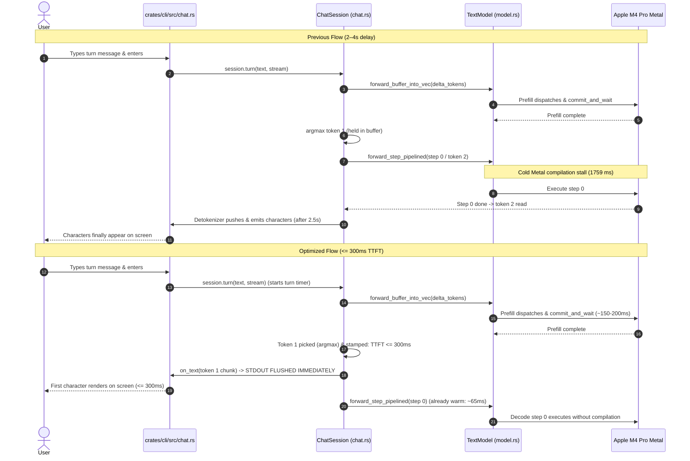

# Technical Plan: Sub-300ms TTFT in Interactive `--chat`

## 1. Architecture & Execution Flow

### Previous Turn Execution vs. Optimized Turn Execution



---

## 2. File / Module Touchpoints

| File Path | Current Behavior | Intended Change |
|---|---|---|
| [`crates/engine/src/model.rs`](file:///Users/zayaantaha/coding/kaplumba/crates/engine/src/model.rs) | `warmup_decode` only calls `forward_buffer`, leaving `forward_step_pipelined` unwarmed. | Warm up `forward_step_pipelined` with dummy inputs during `warmup_decode` so pipeline states and device sampler/argmax kernels are resident in GPU instruction memory. |
| [`crates/engine/src/chat.rs`](file:///Users/zayaantaha/coding/kaplumba/crates/engine/src/chat.rs) | `turn` does not record TTFT. Token 1 chunk is buffered before entering the pipelined decode loop. | Add `ttft_ms` to `TurnStats`. Record `ttft_ms` immediately after prefill wait. Ensure Token 1 is streamed to `on_text` immediately. |
| [`crates/cli/src/chat.rs`](file:///Users/zayaantaha/coding/kaplumba/crates/cli/src/chat.rs) | `print_turn_rate` only shows tok/s and token counts. | Print `[ttft: {stats.ttft_ms:.0} ms, ...]` so latency is visible on every turn. |
| [`crates/engine/tests/probe_chat_ttft.rs`](file:///Users/zayaantaha/coding/kaplumba/crates/engine/tests/probe_chat_ttft.rs) | Non-existent. | Unit probe verifying that `TurnStats` captures `ttft_ms`, and sabotaging Token 1 delivery to confirm failure. |

---

## 3. Detailed Component Designs

### 3.1 Pipelined Warmup in `model.rs`
In `TextModel::warmup_decode`:
```rust
// Warm up the pipelined decode dispatch used exclusively by --chat
let queue = self.forward_queue.clone();
let mut warmup_enc = MetalEncoder::new(&queue).map_err(warmup_error("pipelined_encoder"))?;
warmup_enc.set_max_dispatches(kaplumba_kernels::encoder::decode_max_dispatches_per_buffer());
let _ = self.forward_step_pipelined(
    &mut warmup_enc,
    0,
    Some(1),
    0,
    0,
    HeadPick::Argmax,
);
warmup_enc.commit_and_wait().map_err(warmup_error("pipelined_commit"))?;
self.reset_caches()?;
```

### 3.2 TurnStats & Streaming in `chat.rs`
```rust
#[derive(Debug, Clone, Copy, PartialEq)]
pub struct TurnStats {
    pub prefill_tokens: usize,
    pub generated_tokens: usize,
    pub decode_tok_s: f64,
    pub ttft_ms: f64,
}
```
In `ChatSession::turn`:
```rust
let turn_started = std::time::Instant::now();
...
self.model.forward_buffer_into_vec(&ids, &positions, &mut logits)?;
let ttft_ms = turn_started.elapsed().as_secs_f64() * 1000.0;
...
let mut token = if self.greedy {
    argmax_logits(&logits)
} else {
    ...
};
if self.eos_ids.contains(&token) {
    let decode_s = decode_started.elapsed().as_secs_f64();
    self.record_turn(need, 0, decode_s, ttft_ms, &reply);
    return Ok(reply);
}
generated.push(token);
if let Some(chunk) = detokenizer.push(token)? {
    if !chunk.is_empty() {
        reply.push_str(&chunk);
        on_text(&chunk).map_err(ChatError::from_output)?;
    }
}
```

---

## 4. Sequencing & Task Dependencies

1. **Task 1: Warmup `forward_step_pipelined` in `model.rs` (R1)**
   - Eliminates the 1.76s first-decode stall.
   - Tested via `cargo check --workspace` & lib tests.
2. **Task 2: Token 1 Streaming & `TurnStats::ttft_ms` in `chat.rs` (R2, R3, R4)**
   - Records `ttft_ms`, streams Token 1 immediately.
   - Tested via `cargo test --package kaplumba-engine --lib chat`.
3. **Task 3: Turn Rate Display in `crates/cli/src/chat.rs` (R3)**
   - Prints `ttft: X ms` in terminal turn summary.
   - Tested via `cargo check --workspace`.
4. **Task 4: Automated Test & Sabotage Probe in `probe_chat_ttft.rs` (AC1, AC2)**
   - Probe asserting `ttft_ms` presence and immediate Token 1 delivery.
   - Sabotage run confirming non-vacuity.
5. **Task 5: End-to-End Latency Verification**
   - Verify sub-300ms TTFT in `kaplumba --chat` on short prompts.

---

## 5. Requirement Mapping
- **R1** $\to$ Task 1 (Pipelined decode warmup).
- **R2** $\to$ Task 2 (Immediate Token 1 streaming).
- **R3** $\to$ Task 2 & Task 3 (`TurnStats::ttft_ms` & CLI display).
- **R4** $\to$ Task 2 (Standing RAM KV cache delta prefill).
- **R5** $\to$ Task 1, 2, 5 ($\le 100\text{ ms}$ overhead bound).
