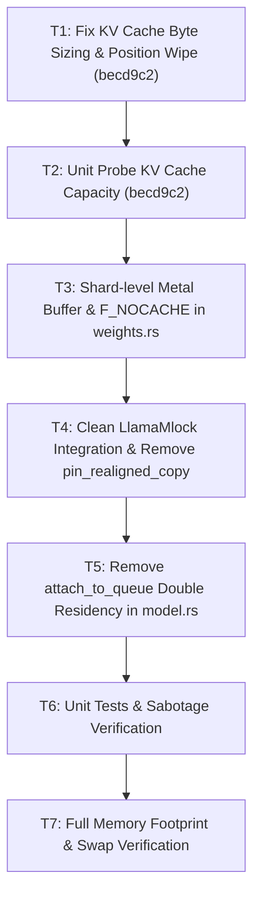

# Technical Plan: `llama.cpp` `mlock` Architecture & Zero-Swap Residency (1x Weights)

## Architecture and Data Flow

### 1. Eliminating 2x Weights Without DART IOMMU Faults
- In previous attempts, two problems arose:
  1. Copying weights into `WeightArena` via `pread` caused macOS to retain 10+ GiB in the file buffer cache beside the anonymous arena (24 GiB total footprint).
  2. Calling `madvise(..., MADV_DONTNEED)` in Phase 2.5 dropped physical pages out from under Metal zero-copy buffers sharing the same 16 KiB hardware pages, triggering fatal `AppleT8110DART` IOMMU panics.
- **The Solution:**
  - Trellis weights stay strictly zero-copy (`skip_copy = true`), reading directly from the `ShardReader` mapping.
  - For `!skip_copy` weights copied into the arena, we apply `fcntl(fd, F_NOCACHE, 1)` to the file descriptor prior to reading. This instructs Darwin to bypass the unified page cache during `pread`, guaranteeing 0 bytes of duplicate OS file cache without any `madvise` manipulation.
  - Phase 2.5 and `reader.drop_cache()` are completely removed.

### 2. Shard-Level Metal Buffer Mapping (16 KiB Page Alignment)
- On Apple Silicon, `sysconf(_SC_PAGESIZE)` is 16,384 bytes.
- Instead of creating 411 fragile per-tensor buffers with `new_buffer_with_bytes_no_copy` (which caused alignment issues when tensors had non-16KB offsets), `ShardReader` creates a single `id<MTLBuffer>` for the entire shard:
  - The shard is mapped via `libc::mmap(MAP_PRIVATE, PROT_READ)`, which is inherently page-aligned to 16 KiB.
  - A Metal buffer is created over `[pointer, length_aligned]`.
  - Any zero-copy tensor in that shard references this shard buffer at `tensor.start`.
  - This perfectly replicates `llama.cpp`'s `ggml_metal_buffer_map` (`reference/llama.cpp/ggml/src/ggml-metal/ggml-metal-device.m`).

### 3. `LlamaMlock` Engine: CPU Host / File `mmap` Only
- In `reference/llama.cpp/src/llama-mmap.cpp`, `llama_mlock` incrementally locks memory:
  ```cpp
  void grow_to(size_t target_size) {
      if (failed_already) return;
      size_t granularity = lock_granularity(); // sysconf(_SC_PAGESIZE) = 16384
      target_size = (target_size + granularity - 1) & ~(granularity - 1);
      if (target_size > size) {
          if (raw_lock((uint8_t *) addr + size, target_size - size)) {
              size = target_size;
          } else {
              failed_already = true;
          }
      }
  }
  ```
- Ported as `LlamaMlock` in `crates/engine/src/weights.rs`:
  - `init(addr: *const c_void)`
  - `grow_to(target_size: usize)` with 16 KiB granularity.
  - Gracefully handles `ENOMEM` / wire limits (`failed_already = true`).
  - **Restriction**: `mlock` is strictly invoked on host `mmap` ranges (`ShardReader`). It is **never** called on `id<MTLBuffer>` pointers (`pin_realigned_copy` is completely removed).

### 4. Metal Residency Set Without Double Registration
- All shard Metal buffers are registered with `ResidencySet`:
  ```rust
  set.add_allocation(&shard_buffer);
  set.commit();
  set.request_residency();
  ```
- In `crates/engine/src/model.rs:3478`, remove `set.attach_to_queue(&forward_queue)`. Device-level residency via `requestResidency` is sufficient and avoids driver duplicate-tracking panics.

### 5. KV Cache 1x Allocation & Position Wipe (Committed in `becd9c2`)
- In `crates/engine/src/gpu_cache.rs:234`:
  Allocate exact 1x capacity (`target * self.stream_len * 2` bytes for FP16), removing the redundant `* 2` multiplier.
- In `crates/engine/src/gpu_cache.rs:283`:
  Wipe `(target - live) * 4` bytes with `0xFF` so all 4 bytes of each uninitialized position slot are reset.

---

## File Touchpoints

| File | Path | Current Behavior | Intended Change |
|---|---|---|---|
| `weights.rs` | `crates/engine/src/weights.rs` | Slices tensors with 4KB alignment in `no_copy_view`; uses `drop_cache` (`MADV_DONTNEED`); has `pin_realigned_copy`. | Wrap entire shard into 16KB page-aligned Metal buffer; remove `drop_cache` and Phase 2.5; use `fcntl(F_NOCACHE)` during arena `pread`; remove `pin_realigned_copy`. |
| `model.rs` | `crates/engine/src/model.rs` | Calls `weights.pin_realigned_copy`; calls `attach_to_queue`. | Remove `pin_realigned_copy` invocation; remove `set.attach_to_queue`. |
| `gpu_cache.rs` | `crates/engine/src/gpu_cache.rs` | Fixed in commit `becd9c2`. | Verified: exact 1x capacity and 4-byte position wipe. |
| `probe_llama_mlock.rs` | `crates/engine/tests/probe_llama_mlock.rs` | Untracked test. | Unit probe for incremental locking, 16KB granularity, and `ENOMEM` soft clamp. |
| `probe_kv_cache_capacity.rs` | `crates/engine/tests/probe_kv_cache_capacity.rs` | Existing test. | Verifies exact 1x byte sizing and tail wipe. |

---

## Sequencing & Dependencies



---

## Requirement to Task Mapping

| Requirement | Satisfied By | Verification |
|---|---|---|
| **R1: Zero-Copy 1x Trellis Residency** | T3 | `probe_shared_weights_footprint` |
| **R2: Port `llama_mlock`** | T4 | `probe_llama_mlock` |
| **R3: Unpinned Embedding Offload** | T3, T4 | `pinned_tensors` excludes embedding |
| **R4: Metal Residency Set** | T5 | Metal execution without driver panics |
| **R5: Fix KV Cache Double Allocation** | T1 (done) | `probe_kv_cache_capacity` |
| **R6: Fix Position Buffer Wipe** | T1 (done) | `probe_kv_cache_capacity` |
| **R7: Direct I/O via `F_NOCACHE`** | T3 | Page cache inspection during load |
| **R8: Memory Pressure Green** | T3, T4, T5, T7 | `PhysMem` / `top` verification |
| **R9: Zero Swap Growth** | T3, T4, T5, T7 | `sysctl -n vm.swapusage` |
