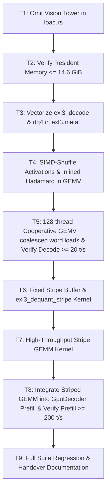

# Technical Plan: Performance and Memory Overhaul

## Architecture and Data Flow

### 1. Memory Layout (Loader)
```
model.safetensors.index.json
  ├─ model.language_model.* (60 layers + norm)  ──> Loaded into Metal buffers (12.06 GB)
  ├─ lm_head.*                                  ──> Loaded into Metal buffers (1.06 GB)
  ├─ model.language_model.embed_tokens.*         ──> Loaded into Metal buffers (2.82 GB)
  └─ model.vision_tower.* & model.embed_vision.* ──> FILTERED OUT (SKIPPED) (-1.15 GB)
Total weights in resident Metal memory: 14.88 GB (13.85 GiB)
```

### 2. Decode Execution Flow (Rows = 1)
```
x (1 row, hidden dim)
  │
  ▼
[inlined had_in prologue inside exl3_gemv]
  │  (Multiplies x * suh, runs 7-stage in-place butterfly in threadgroup float tg_xh[128])
  ▼
[dq4 + simd_shuffle GEMV core]
  │  (Lane loads x_lane from tg_xh once; fetches row elements via simd_shuffle at register speed)
  │  (Lane loads two 32-bit words, extracts 4 codewords cw0..cw3 in one 64-bit window)
  │  (Accumulates 8 weights per lane in registers; simd_shuffle_down warp reduction: zero barrier, zero shared memory)
  ▼
y (raw float output)
  │
  ▼
[exl3_had_out] ──> out (f16)
```

### 3. Prefill Execution Flow (Rows ≥ 64)
```
x (m rows, in_features)
  │
  ▼
[had_in] ──> xh (m rows)
  │
  ▼
[Fixed 16 MB Stripe Scratch Buffer]
  For each stripe of 512 out_columns:
    1. fast_dequantize_stripe: unpack EXL3 trellis tile into FP16 stripe (512 cols × in_features)
    2. tiled_gemm_stripe: xh @ stripe_weights using hardware-optimized simdgroup matrix multiply
       (runs at 14–16+ TFLOP/s)
  │
  ▼
y (m rows, out_features)
  │
  ▼
[had_out] ──> out (f16)
```

---

## File and Module Touchpoints

1. `crates/engine/src/load.rs`:
   - *Current*: Loops over all entries in `weight_map` and packs them into shard buffers.
   - *Change*: Filter out any key where `name.starts_with("model.vision_tower.")` or `name.starts_with("model.embed_vision.")`.
   - *Impact*: Saves 1,151,192,640 bytes (1.15 GB) of Metal device allocations.

2. `crates/kernels/src/exl3.metal`:
   - *Current (post T3/T4)*: `exl3_gemv` has dq4 windows + simd_shuffle activations, but still runs one 32-lane warp per out-tile (`WARPS=1`) with per-lane `ld_word` loads and no K-split-aware cooperative structure that saturates narrow shapes.
   - *Change (T5, in-place — divergence from the original `exl3_gemv_fast` sketch, approved 2026-09-23)*:
     - Rewrite `exl3_gemv` to 128 threads/TG (4 simdgroups): `tk += 4` in-tile striding, private `accA/accB` registers, on-chip `tg_cols[4][16]` reduction, single output store (no DRAM partials for the intra-TG reduction).
     - Coalesced tile word loads (ExllamaV3 style): when `aligned && twords <= 32`, lanes `0..twords-1` load the tile's u32 words in one contiguous burst; lanes fetch their `ig0/ig1` words via `simd_shuffle`. k=6 (lm_head, 48 words) and unaligned tensors keep the per-lane `ld_word` fallback.
     - Keep `accA/accB` (2 accumulators per lane) — no ExllamaV3 `acc[8]` remap (regression-risk decision, T5.2 scope cut approved).
     - (T6/T7 only) Add `exl3_dequant_stripe` / `exl3_stripe_gemm` kernels.

3. `crates/kernels/src/exl3.rs`:
   - *Current*: `gemv_splits` K-split policy + `exl3_gemv` pipeline; dispatch `WARPS=1` × 32 threads.
   - *Change (T5)*: dispatch 128 threads/TG, one TG per out-tile; `gemv_splits(in_tiles, out_tiles)` retuned to the cooperative heuristic (`min_split_tiles = 128`, target `out_tiles * n < 8192`, doubling while `in_tiles / (2n) >= 128`) → lm 1, gate/q/k/v 2, o 4, down 8. (T6–T8) stripe pipelines.

4. `crates/engine/src/gpu_decode.rs`:
   - *Current*: Uses `self.lin_temps` for `encode_linear_with_scratch`; prefill calls `encode_span` using `exl3_gemm_sg`.
   - *Change (T5)*: **none** — split policy flows through `encode_linear_with_scratch`; arena already ORs `gemv_partial_bytes` (`metal_linear.rs`). (T8) stripe buffer + `encode_span` striped path.

---

## Sequencing and Dependencies



---

## Risks and Fallbacks

1. **Greedy Token Re-association**:
   - *Risk*: Switching accumulation order in GEMV or striped GEMM may flip a low-margin argmax token.
   - *Mitigation*: Test position-0 golden fixture (`236773`) and maintain numerical bounds checks (`span-vs-loop < 0.55`).
2. **Memory Alignment on Shard Loading**:
   - *Risk*: Skipping tensors in safetensors could offset 64-byte alignment logic.
   - *Mitigation*: The repacking layout code in `load.rs` already computes packed device offsets `dev = dev.div_ceil(64) * 64` sequentially per retained tensor; skipping vision tensors simply omits them from `by_file` layout cleanly.
3. **Coalesced word-load correctness (T2.3 dead-end recall)**:
   - *Risk*: An earlier tile-staging-through-threadgroup attempt returned wrong columns (pairs q=0/q=2 resolved identically).
   - *Mitigation*: The T5 coalesced path stages words in **registers** (`w_lane` + `simd_shuffle`), not threadgroup memory; verify with `debug_gemv_rows` one-hot probes + `gpu_gemv_matches_cpu_decoded_tile` before commit; fall back to per-lane `ld_word` path whenever `twords > 32` or unaligned.
4. **K-split f32 reassociation**:
   - *Risk*: New nsplit values (up to 8 on down) reassociate partial sums → possible mid-sequence greedy flips.
   - *Mitigation*: Token gates are position-0 fixture + span/batched bounds (established spec property, not cross-build mid-sequence identity); tune splits, never loosen gates.
5. **Ceiling conflict with `spec/final-same-algorithm-ceiling`**:
   - Its T6.1 documents 18/200 t/s as unreachable and T2.12 caps k/v nsplit ≤ 4 — both predate this cooperative GEMV design. Approved (2026-09-23): amend both with supersession/caveat notes when T5 lands (T5.5).

---

## Requirements Mapping

| Requirement | Tasks | Verification Method |
|---|---|---|
| R1: Vision Tower Omission | T1 | `load_real_artifact_if_present` asserts weights ≤ 14.9 GB |
| R2: Resident Memory ≤ 14.6 GiB | T1, T2 | `prefill_memory_profile_slow` asserts baseline RSS |
| R3: dq4 + SIMD Shuffle GEMV | T3, T4 | `gpu_gemv_matches_cpu_decoded_tile`, `bench_passes_slow` |
| R4: Inlined Hadamard Input | T4 | Single-dispatch linear verification, unit parity |
| R5: Decode Throughput ≥ 20.0 t/s | T5 | `decode_throughput_slow` ≥ 19.5 t/s gate (target ≥ 20.0) |
| R6: Fixed-Size Stripe Prefill | T6, T7 | RSS growth ≤ 48 MB across 1k/2k/8k tokens |
| R7: Prefill Throughput ≥ 200 t/s | T7, T8 | `prefill_throughput_slow` ≥ 200.0 t/s |
