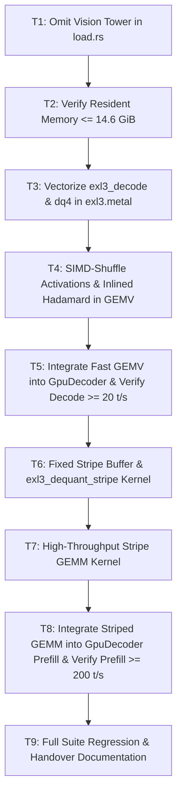

# Technical Plan: Performance and Memory Overhaul

## Architecture and Data Flow

### 1. Memory Layout (Loader)
```
model.safetensors.index.json
  ├─ model.language_model.* (60 layers + norm)  ──> Loaded into Metal buffers (12.06 GB)
  ├─ lm_head.*                                  ──> Loaded into Metal buffers (1.06 GB)
  ├─ model.language_model.embed_tokens.*         ──> Loaded into Metal buffers (2.82 GB)
  └─ model.vision_tower.* & model.embed_vision.* ──> FILTERED OUT (SKIPPED) (-1.15 GB)
Total weights in resident Metal memory: 14.88 GB (13.85 GiB)
```

### 2. Decode Execution Flow (Rows = 1)
```
x (1 row, hidden dim)
  │
  ▼
[inlined had_in prologue inside exl3_gemv]
  │  (Multiplies x * suh, runs 7-stage in-place butterfly in threadgroup float tg_xh[128])
  ▼
[dq4 + simd_shuffle GEMV core]
  │  (Lane loads x_lane from tg_xh once; fetches row elements via simd_shuffle at register speed)
  │  (Lane loads two 32-bit words, extracts 4 codewords cw0..cw3 in one 64-bit window)
  │  (Accumulates 8 weights per lane in registers; simd_shuffle_down warp reduction: zero barrier, zero shared memory)
  ▼
y (raw float output)
  │
  ▼
[exl3_had_out] ──> out (f16)
```

### 3. Prefill Execution Flow (Rows ≥ 64)
```
x (m rows, in_features)
  │
  ▼
[had_in] ──> xh (m rows)
  │
  ▼
[Fixed 16 MB Stripe Scratch Buffer]
  For each stripe of 512 out_columns:
    1. fast_dequantize_stripe: unpack EXL3 trellis tile into FP16 stripe (512 cols × in_features)
    2. tiled_gemm_stripe: xh @ stripe_weights using hardware-optimized simdgroup matrix multiply
       (runs at 14–16+ TFLOP/s)
  │
  ▼
y (m rows, out_features)
  │
  ▼
[had_out] ──> out (f16)
```

---

## File and Module Touchpoints

1. `crates/engine/src/load.rs`:
   - *Current*: Loops over all entries in `weight_map` and packs them into shard buffers.
   - *Change*: Filter out any key where `name.starts_with("model.vision_tower.")` or `name.starts_with("model.embed_vision.")`.
   - *Impact*: Saves 1,151,192,640 bytes (1.15 GB) of Metal device allocations.

2. `crates/kernels/src/exl3.metal`:
   - *Current*: `exl3_gemv` runs 4 `funnel_pair` calls with redundant 64-bit loads and scalar decode instructions; reads `xh` repeatedly from device memory; separate `exl3_had_in` dispatch.
   - *Change*:
     - Add `exl3_gemv_fast` with inlined Hadamard prologue (`tg_xh`), SIMD shuffle for `x`, `dq4` window unpacking, `half2` vector decoding, and `simd_shuffle_down` warp reduction.
     - Add `exl3_dequant_stripe` kernel to decode 512 columns of EXL3 weights into FP16 buffer.
     - Add `exl3_stripe_gemm` kernel to run high-throughput FP16 tiled GEMM on the decoded stripe.

3. `crates/kernels/src/exl3.rs`:
   - *Current*: Host pipeline management for `exl3_gemv`, `exl3_gemm_sg`.
   - *Change*: Add pipelines for `exl3_gemv_fast`, `exl3_dequant_stripe`, `exl3_stripe_gemm`. Implement host dispatch logic for striped GEMM.

4. `crates/engine/src/gpu_decode.rs`:
   - *Current*: Uses `self.lin_temps` for `encode_linear_with_scratch`; prefill calls `encode_span` using `exl3_gemm_sg`.
   - *Change*: Integrate fixed 16 MB stripe buffer into `lin_temps`/`GpuDecoder`. Direct `encode_token` to `exl3_gemv_fast` and `encode_span` to striped prefill GEMM.

---

## Sequencing and Dependencies



---

## Risks and Fallbacks

1. **Greedy Token Re-association**:
   - *Risk*: Switching accumulation order in GEMV or striped GEMM may flip a low-margin argmax token.
   - *Mitigation*: Test position-0 golden fixture (`236773`) and maintain numerical bounds checks (`span-vs-loop < 0.55`).
2. **Memory Alignment on Shard Loading**:
   - *Risk*: Skipping tensors in safetensors could offset 64-byte alignment logic.
   - *Mitigation*: The repacking layout code in `load.rs` already computes packed device offsets `dev = dev.div_ceil(64) * 64` sequentially per retained tensor; skipping vision tensors simply omits them from `by_file` layout cleanly.

---

## Requirements Mapping

| Requirement | Tasks | Verification Method |
|---|---|---|
| R1: Vision Tower Omission | T1 | `load_real_artifact_if_present` asserts weights ≤ 14.9 GB |
| R2: Resident Memory ≤ 14.6 GiB | T1, T2 | `prefill_memory_profile_slow` asserts baseline RSS |
| R3: dq4 + SIMD Shuffle GEMV | T3, T4 | `gpu_gemv_matches_cpu_decoded_tile`, `bench_passes_slow` |
| R4: Inlined Hadamard Input | T4 | Single-dispatch linear verification, unit parity |
| R5: Decode Throughput ≥ 18.0 t/s | T5 | `decode_throughput_slow` ≥ 18.0 t/s |
| R6: Fixed-Size Stripe Prefill | T6, T7 | RSS growth ≤ 48 MB across 1k/2k/8k tokens |
| R7: Prefill Throughput ≥ 200 t/s | T7, T8 | `prefill_throughput_slow` ≥ 200.0 t/s |
