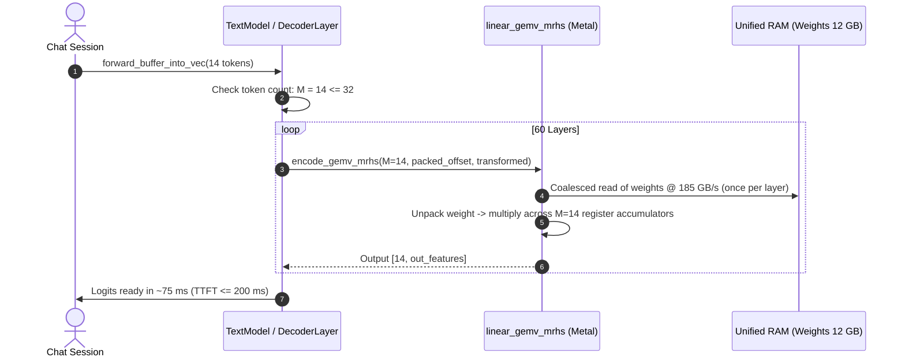

# Technical Plan: Small-Batch High-Bandwidth Prefill (Multi-RHS GEMV)

## 1. Architecture and Data Flow



### Roofline Analysis & Why Multi-RHS Succeeds
- **FLOPs for $M=14$ tokens:** $2 \times 14 \times 31\times 10^9 \approx 0.87 \text{ TFLOP}$.
- **Compute capability of M4 Pro (fp16):** ~40 TFLOPS.
- **Compute duration:** $0.87 / 40 \approx 21\text{ ms}$.
- **Weights footprint:** $12.04\text{ GB}$.
- **Bandwidth streaming duration at 185 GB/s:** $12.04 / 185 \approx 65\text{ ms}$.
- **Theoretical duration:** $\max(65\text{ ms}, 21\text{ ms}) \approx \mathbf{65\text{ – }80\text{ ms}}$.
- **Current `linear_gemm_mma` duration:** **1325 ms** (because occupancy is 1.6 threadgroups/core and threadgroups stall on barriers).
- **Multi-RHS GEMV:** Employs 640 threadgroups, keeps weights in registers with zero threadgroup barriers, achieving the same 185 GB/s streaming as single-token decode.

---

## 2. File / Module Touchpoints

| File Path | Current Behavior | Intended Change |
| :--- | :--- | :--- |
| [`crates/kernels/src/linear.metal`](file:///Users/zayaantaha/coding/kaplumba/crates/kernels/src/linear.metal) | Contains `linear_gemv_exl3_k3_mcg` ($M=1$) and `linear_gemm_mma` ($M=128$). | Add `linear_gemv_mrhs_exl3_k3_mcg` supporting $M \in [1, 32]$ query vectors with register accumulators. |
| [`crates/kernels/src/linear.rs`](file:///Users/zayaantaha/coding/kaplumba/crates/kernels/src/linear.rs) | Only defines `encode_gemv` ($M=1$) and `encode_gemm` ($M>1$). | Add `encode_gemv_mrhs` pipeline registration and dispatch. |
| [`crates/engine/src/model.rs`](file:///Users/zayaantaha/coding/kaplumba/crates/engine/src/model.rs) | Routes any `tokens > 1` through `encode_gemm`. | Route `1 < tokens <= 32` through `encode_gemv_mrhs`. |
| [`crates/kernels/tests/linear_mrhs.rs`](file:///Users/zayaantaha/coding/kaplumba/crates/kernels/tests/linear_mrhs.rs) | Non-existent. | Unit probe validating `encode_gemv_mrhs` parity against single-vector GEMV and CPU reference. |

---

## 3. Interfaces and Dispatch Parameters

### 3.1 Kernel Signature
```metal
kernel void linear_gemv_mrhs_exl3_k3_mcg(
    const device ushort *packed [[buffer(0)]],
    const device half *input [[buffer(1)]],      // [M, in_features]
    device float *output [[buffer(2)]],           // [M, out_features]
    constant LinearParams &params [[buffer(3)]],
    uint gid [[thread_position_in_grid]],
    uint lid [[thread_position_in_threadgroup]],
    uint sg [[simdgroup_index_in_threadgroup]],
    uint tn [[threadgroup_position_in_grid]],
    uint tgdim [[threads_per_threadgroup]]);
```

### 3.2 Threadgroup & Grid Sizing
- `threadgroup_size`: 256 threads (8 simdgroups of 32 threads).
- `tiles`: `out_features / 16`.
- `groups`: `tiles * 2` (SK2 layout).
- Grid dimensions: `groups * 256` threads in 1D.

---

## 4. Risks & Fallbacks

1. **Register Pressure:** For large $M$ (e.g. $M > 32$), 32 float accumulators per thread may risk register spilling.
   - *Mitigation:* Hard threshold at $M \le 32$. Any query with $M > 32$ routes to `linear_gemm_mma`.
2. **Numerical Divergence:** FMA reordering across multiple rows.
   - *Mitigation:* Accumulators strictly use fp32 addition identical to `linear_gemv`.
3. **Fallback Switch:** A debug environment variable `KAPLUMBA_DISABLE_MRHS=1` will instantly force the system back to `linear_gemm_mma` for A/B testing and fallback.

---

## 5. Requirement Mapping

- **R1** $\to$ Task 1 (Metal kernel implementation).
- **R2** $\to$ Task 2 (Rust kernel wrapper in `linear.rs`).
- **R3** $\to$ Task 3 (Engine dynamic routing in `model.rs`).
- **R4** $\to$ Task 4 (`chat.rs` delta prefill verification).
- **R5** $\to$ Task 5 (End-to-end benchmark & latency validation).
